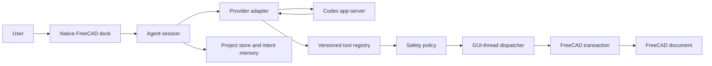

# AgentCAD architecture

AgentCAD keeps FreeCAD, agent orchestration, and model providers behind explicit
boundaries.

## Boundaries

### Native UI

The panel uses ordinary Qt widgets, FreeCAD's application palette, the standard
dock system, and standard FreeCAD commands. It does not replace FreeCAD's main
window or themes.

### Agent session

The session builds a compact state packet, selects the active conversation and
memory, invokes a provider, dispatches tool calls, and records the final turn.
It contains no provider-specific wire protocol.

### Provider adapters

Providers implement one interface. The initial adapter launches the official
Codex app-server over JSONL and supplies AgentCAD tools as dynamic function
tools. Future providers can implement the same interface without changing the
UI, memory, or CAD tools.

The Codex process receives a minimal environment and a custom permission
profile. Sandboxed commands can read only operating-system runtime files and
the isolated AgentCAD runtime root. AgentCAD interrupts and closes a turn if it
attempts any built-in command or non-AgentCAD capability. A stable, private,
AgentCAD-managed Codex home preserves provider thread state across restarts
without importing user-configured MCP servers, plugins, skills, rules, or
general configuration.

### Tool registry

Every tool has a stable name, version, JSON input schema, safety level,
document requirement, and handler. The provider receives only tools permitted
by the current policy.

### Transactions

FreeCAD changes occur on the GUI thread. Each mutation validates its arguments,
opens one undo transaction, recomputes, verifies a postcondition, and commits.
An exception or failed postcondition aborts the transaction.

### Project memory

Saved CAD documents map to local AgentCAD projects under FreeCAD's user data
directory. A project contains a manifest, conversations, structured intent
memory, runtime state, and an append-only redacted activity log. Writes are
atomic, local files use owner-only permissions, and formats are versioned.

## Initial tool surface

- document state and selection inspection
- viewport fitting and standard views
- boxes, cylinders, and spheres
- Part boolean union, cut, and intersection
- shape measurement and validity checks
- durable requirement, constraint, preference, decision, and question memory

Native Sketcher and PartDesign feature tools are the next modeling surface.
They will be added only with reliable postconditions and cross-platform FreeCAD
tests.
